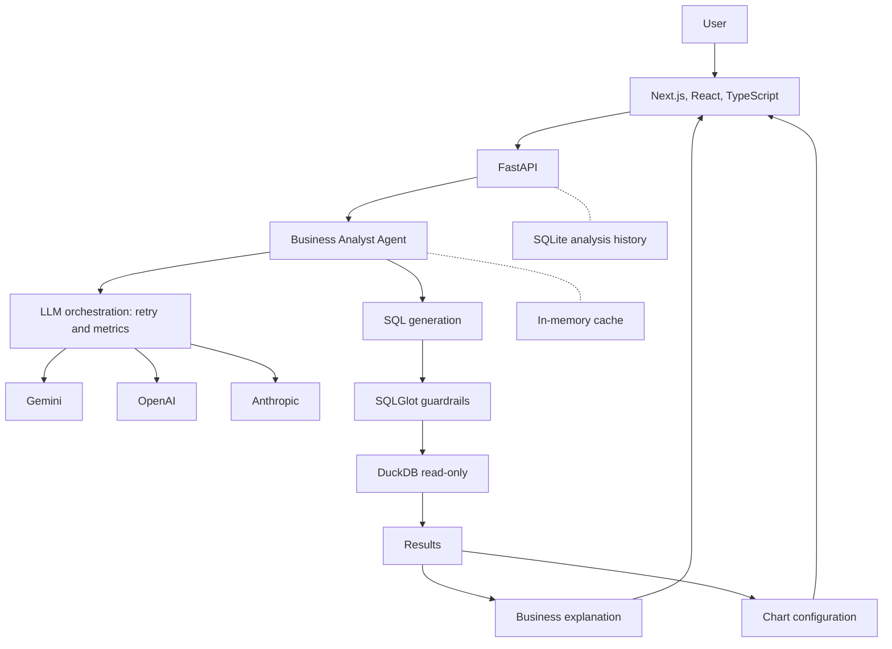
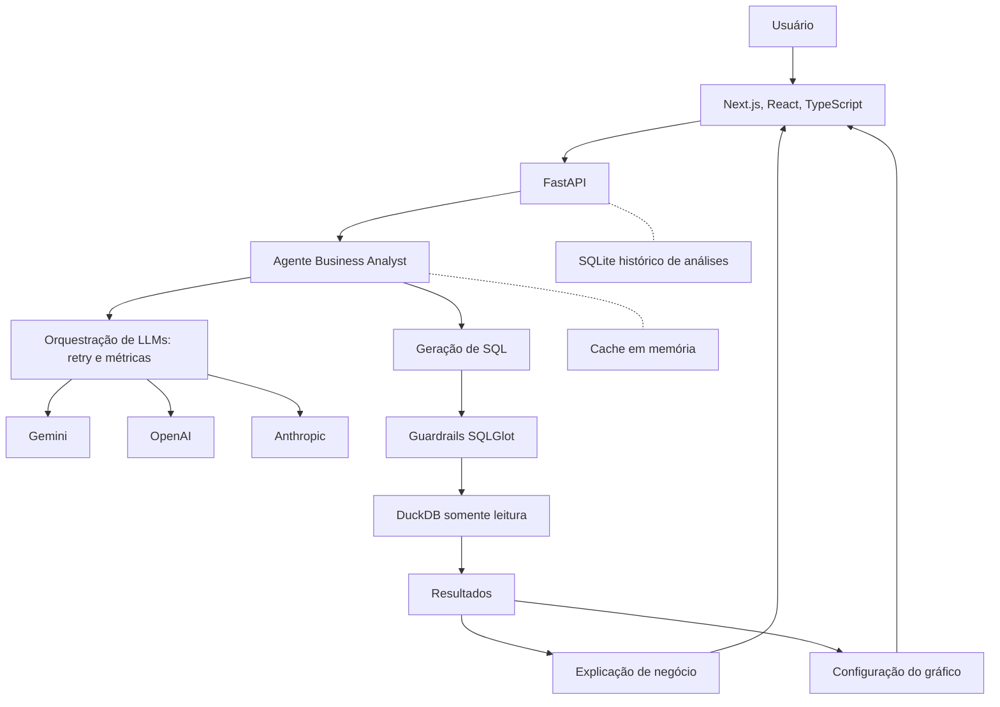

<!-- Rewritten README. Assets listed in docs/assets/README.md are recorded manually. -->
<a id="top"></a>

<div align="center">


<br/>


[](https://github.com/nascimentomacedodani487-hue/ai-business-analyst/actions/workflows/ci.yml)
-0e7490?style=flat-square)

**[English](#english)** · **[Português](#portugues)**

</div>

---

<a id="english"></a>

# English

**AI Business Analyst is an AI-powered business intelligence product, not a simple chatbot.** A user asks a business question in natural language; an agent turns it into SQL, a guardrail layer validates the query at the AST level, a read-only DuckDB connection executes it, and the application returns a table, a chart and a written business interpretation, with the whole execution timeline visible.

> **Status:** active development (v0.1.0). It runs locally; there is no hosted deployment and no production claim. The dataset is synthetic.

**Contents:** [Product experience](#product-experience) · [Capabilities](#core-capabilities) · [Architecture](#architecture) · [Security](#security-and-reliability) · [Dataset](#dataset) · [Stack](#technology-stack) · [Installation](#installation) · [Testing](#testing-and-quality) · [Automation](#automation) · [Roadmap](#roadmap)

## Product experience

<!-- When docs/assets/demo.gif exists, replace the note below with:
<p align="center"></p>
-->

> **Demo GIF: pending recording.** The real-application GIF (`docs/assets/demo.gif`) has to be recorded on a machine running the app with an LLM key. Recording instructions are in [`docs/assets/README.md`](docs/assets/README.md). No simulated screenshots are used here.

| Step | What happens | Where it lives |
|---|---|---|
| 1 | The user asks a business question | `frontend/app/page.tsx` |
| 2 | The agent interprets the request and builds schema context | `agent/context.py`, `agent/business_analyst.py` |
| 3 | The selected LLM provider generates SQL | `agent/sql_generator.py`, `llm/` |
| 4 | SQLGlot guardrails validate the query | `security/guardrails.py` |
| 5 | Read-only DuckDB executes it (up to 2 correction attempts on recoverable errors) | `agent/sql_executor.py`, `data/db.py` |
| 6 | Results are interpreted and a chart configuration is built | `agent/response_generator.py` |
| 7 | The UI shows table, chart, explanation and execution timeline | `components/agent-timeline.tsx`, `components/analytics-chart.tsx` |

### Pipeline at a glance

The block below is an **illustrative visualization of the workflow, not live terminal output.** To show a real run, record one with [ScreenToGif](https://www.screentogif.com/) or [asciinema](https://asciinema.org/) and save it under `docs/assets/`.

```text
[ SYSTEM    ] AI BUSINESS ANALYST INITIALIZED
[ AGENT     ] Interpreting business question...
[ LLM       ] Generating SQL query...
[ SECURITY  ] Validating SQL AST...
[ DATABASE  ] Executing analytical query (read-only)...
[ ANALYTICS ] Processing results...
[ INSIGHT   ] Generating business explanation...
[ COMPLETE  ] Analysis ready.
```

## Core capabilities

<table>
<tr>
<td width="50%" valign="top">

**AI business intelligence**
- Natural-language questions over a delivery marketplace
- SQL generation, result interpretation and written explanations
- Table and chart output (Recharts)

**Multi-LLM architecture**
- Gemini, OpenAI and Anthropic behind a common provider interface
- Provider chosen per request; default models: `gemini-2.5-flash`, `gpt-4.1-mini`, `claude-haiku-4-5-20251001`
- Retry with exponential backoff for transient failures (3 attempts)

**Agent orchestration**
- Staged workflow: cache lookup, SQL generation, validation, execution, response, chart
- Up to 2 SQL correction attempts on recoverable errors
- In-memory result cache (30 min TTL, 100 entries)

</td>
<td width="50%" valign="top">

**Analysis management**
- Persistent history in SQLite with search, filters and pagination
- Pin, lock, archive, rename, delete and restore analyses
- Projects to organize analyses

**Observability**
- `X-Request-ID` on every API response
- Structured logging with request IDs
- Per-stage timing in the execution timeline
- LLM metrics endpoint (`GET /metrics/llm`) including retries

**API surface**
- `GET /health`, `GET /data/catalog`, `POST /analyze`
- History and project management routes under `/analyses/history` and `/analysis-projects`
- Interactive docs at `http://127.0.0.1:8000/docs`

</td>
</tr>
</table>

## Architecture



**Architectural decisions**

- **Separation of concerns:** `agent/` (orchestration), `llm/` (providers), `security/` (guardrails), `data/` (databases), `api/` (HTTP).
- **Provider abstraction:** a factory builds Gemini, OpenAI or Anthropic clients behind one interface and wraps them with retry logic.
- **SQL validation before execution:** generated SQL is parsed and checked as an AST, never trusted as text.
- **Read-only analytical access:** DuckDB opens in read-only mode with external access disabled and configuration locked.
- **Persistence:** analysis history and projects live in SQLite, separate from the analytical DuckDB.
- **Observability and errors:** request IDs, stage timings, LLM metrics and explicit handling of provider failures and rate limits.

## Security and reliability

These are security controls designed to restrict LLM-generated queries to the intended analytical environment. They are not a claim of absolute security.

| Control | Implementation |
|---|---|
| AST validation | SQL parsed with SQLGlot before execution |
| SELECT-only | Any root node other than `SELECT` is rejected |
| Single statement | Multiple statements are rejected |
| Blocked functions | File, scan and extension functions (for example `read_csv`, `read_parquet`, `glob`, `pragma`, `install`, `load`) are blocked, including as table sources |
| Table allowlist | Only `orders`, `restaurants`, `customers` and `couriers`; schema- or catalog-qualified tables are rejected |
| Read-only database | DuckDB connection with `read_only=True` |
| No external files | `enable_external_access` disabled and `lock_configuration` enabled |
| Provider failures | Retry with backoff; failures surfaced as controlled errors and recorded in metrics |
| SQL correction | Recoverable SQL errors trigger up to 2 correction requests to the LLM |

The repository includes automated tests for the guardrails, SQL executor, LLM retry logic, cache, history and API.

## Dataset

The dataset is **100% synthetic**, generated by `src/ai_analyst/data/generate.py` with a fixed seed (`42`), so every run reproduces the same data.

| Entity | Records |
|---|---|
| Restaurants | 200 |
| Customers | 5,000 |
| Delivery partners | 300 |
| Orders | 60,000 |

Five cities, orders from 2025. Patterns were injected on purpose: lunch and dinner peaks, higher demand from Friday to Sunday, and rain increasing delivery time and cancellations. Of the 60,000 orders, 57,828 are delivered and 2,172 are cancelled (a 3.62% cancellation rate).

> Insights reflect these generated rules, not real marketplace behavior, and must not be read as business benchmarks.

## Technology stack

| Layer | Technologies |
|---|---|
| Backend | Python 3.11+, FastAPI, Uvicorn, Pydantic |
| Frontend | Next.js 16, React 19, TypeScript, Tailwind CSS |
| Data | DuckDB, SQLite, Pandas, NumPy |
| AI | Gemini (`google-genai`), OpenAI, Anthropic |
| Security | SQLGlot |
| Visualization | Recharts |
| Testing | Pytest, TypeScript compiler (`tsc`) |
| Development | Git, GitHub Actions, Node.js, npm |

## Installation

Flow written for Windows PowerShell; requires Python 3.11+ and Node.js 20.9+.

```powershell
# 1. Clone
git clone https://github.com/nascimentomacedodani487-hue/ai-business-analyst.git
cd ai-business-analyst

# 2-4. Virtual environment + backend dependencies
python -m venv .venv
.\.venv\Scripts\Activate.ps1
pip install -e ".[dev]"

# 5. Configure API keys (set at least one provider key in .env)
Copy-Item .env.example .env

# 6. Generate the DuckDB database (data/delivery.duckdb)
python -m ai_analyst.data.db

# 7. Start the API at http://127.0.0.1:8000
python -m uvicorn ai_analyst.api.main:app --reload
```

In a second terminal:

```powershell
# 8-9. Frontend dependencies and API URL
cd frontend
npm install
"NEXT_PUBLIC_API_URL=http://127.0.0.1:8000" | Out-File -Encoding ascii .env.local

# 10. Start Next.js
npm run dev
```

**11.** Open **http://localhost:3000** (use `localhost`, because the API CORS policy allows only `http://localhost:3000`).

`.env` keys: `GEMINI_API_KEY`, `OPENAI_API_KEY`, `ANTHROPIC_API_KEY`. Only the provider you select needs a key. `LLM_PROVIDER` is optional and defaults to `gemini` for code paths without an explicit provider. Never commit `.env`; it is git-ignored.

## Testing and quality

```powershell
# Backend
pytest -q

# Frontend (generate Next.js route types first, then type-check)
cd frontend
npx next typegen
npx tsc --noEmit

```

Last verified on 2026-11-06 from a clean clone: **195 backend tests passed** and the TypeScript check completed without errors. Tests do not call paid LLM APIs. These are point-in-time results; the [CI workflow](#automation) re-checks them on every push.

## Automation

| Workflow | Trigger | Purpose |
|---|---|---|
| [`ci.yml`](.github/workflows/ci.yml) | push to `main`, pull requests | Runs `pytest` and the frontend `tsc` check; read-only permissions, no secrets |
| [`snake.yml`](.github/workflows/snake.yml) | daily + manual | Generates the contribution snake and publishes it to the `output` branch |

<div align="center">


</div>

The snake is decorative and shows the **contribution graph of the owner's GitHub account, not this repository's activity.** It appears only after `snake.yml` has run once: in the repository go to **Settings → Actions → General** and allow actions, then open **Actions → Generate Snake → Run workflow**. The image is served from the `output` branch.

<details>
<summary><b>About the author (GitHub account cards)</b></summary>

<br/>

<div align="center">

<a href="https://github.com/nascimentomacedodani487-hue/ai-business-analyst"></a>


<br/>

[](https://www.linkedin.com/in/daniel-macedo-54bb46210/)
[](https://github.com/nascimentomacedodani487-hue)

</div>

The top-languages card reflects the whole account, not only this project. A "now playing" Spotify widget is optional and needs a separate Spotify integration or service; it is not included.

</details>

## Roadmap

Only items not yet implemented:

- [ ] Systematic LLM evaluation (question set with expected SQL, accuracy per model)
- [ ] Side-by-side provider comparison
- [ ] Broader automated testing of the frontend
- [ ] Hosted deployment

<p align="right"><a href="#top">Back to top ↑</a></p>

---

<a id="portugues"></a>

# Português

**O AI Business Analyst é um produto de inteligência de negócios com IA, não um simples chatbot.** O usuário faz uma pergunta de negócio em linguagem natural; um agente a transforma em SQL, uma camada de guardrails valida a consulta no nível da AST, uma conexão DuckDB somente leitura a executa, e a aplicação devolve tabela, gráfico e uma interpretação de negócio escrita, com toda a linha do tempo de execução visível.

> **Status:** em desenvolvimento ativo (v0.1.0). Roda localmente; não há deploy hospedado nem alegação de produção. Os dados são sintéticos.

**Conteúdo:** [Experiência do produto](#experiência-do-produto) · [Capacidades](#capacidades) · [Arquitetura](#arquitetura) · [Segurança](#segurança-e-confiabilidade) · [Conjunto de dados](#conjunto-de-dados) · [Tecnologias](#tecnologias) · [Instalação](#instalação) · [Testes](#testes-e-qualidade) · [Automação](#automação-de-workflows) · [Próximos passos](#próximos-passos)

## Experiência do produto

<!-- Quando docs/assets/demo.gif existir, substitua a nota abaixo por:
<p align="center"></p>
-->

> **GIF de demonstração: gravação pendente.** O GIF da aplicação real (`docs/assets/demo.gif`) precisa ser gravado em uma máquina com o app rodando e uma chave de LLM. As instruções estão em [`docs/assets/README.md`](docs/assets/README.md). Nenhuma captura simulada é usada aqui.

| Etapa | O que acontece | Onde está |
|---|---|---|
| 1 | O usuário faz uma pergunta de negócio | `frontend/app/page.tsx` |
| 2 | O agente interpreta o pedido e monta o contexto do schema | `agent/context.py`, `agent/business_analyst.py` |
| 3 | O provedor de LLM selecionado gera o SQL | `agent/sql_generator.py`, `llm/` |
| 4 | Os guardrails do SQLGlot validam a consulta | `security/guardrails.py` |
| 5 | O DuckDB somente leitura executa (até 2 correções em erros recuperáveis) | `agent/sql_executor.py`, `data/db.py` |
| 6 | Os resultados são interpretados e a configuração do gráfico é montada | `agent/response_generator.py` |
| 7 | A interface mostra tabela, gráfico, explicação e linha do tempo | `components/agent-timeline.tsx`, `components/analytics-chart.tsx` |

### O pipeline em resumo

O bloco abaixo é uma **visualização ilustrativa do fluxo, não uma saída real de terminal.** Para mostrar uma execução real, grave com o [ScreenToGif](https://www.screentogif.com/) ou o [asciinema](https://asciinema.org/) e salve em `docs/assets/`.

```text
[ SYSTEM    ] AI BUSINESS ANALYST INITIALIZED
[ AGENT     ] Interpreting business question...
[ LLM       ] Generating SQL query...
[ SECURITY  ] Validating SQL AST...
[ DATABASE  ] Executing analytical query (read-only)...
[ ANALYTICS ] Processing results...
[ INSIGHT   ] Generating business explanation...
[ COMPLETE  ] Analysis ready.
```

## Capacidades

<table>
<tr>
<td width="50%" valign="top">

**Inteligência de negócios com IA**
- Perguntas em linguagem natural sobre um marketplace de delivery
- Geração de SQL, interpretação dos resultados e explicações escritas
- Saída em tabela e gráfico (Recharts)

**Arquitetura multi-LLM**
- Gemini, OpenAI e Anthropic atrás de uma interface comum de provedor
- Provedor escolhido por requisição; modelos padrão: `gemini-2.5-flash`, `gpt-4.1-mini`, `claude-haiku-4-5-20251001`
- Retry com backoff exponencial para falhas transitórias (3 tentativas)

**Orquestração do agente**
- Fluxo em etapas: consulta ao cache, geração de SQL, validação, execução, resposta, gráfico
- Até 2 tentativas de correção de SQL em erros recuperáveis
- Cache de resultados em memória (TTL de 30 min, 100 entradas)

</td>
<td width="50%" valign="top">

**Gestão de análises**
- Histórico persistente em SQLite com busca, filtros e paginação
- Fixar, bloquear, arquivar, renomear, excluir e restaurar análises
- Projetos para organizar as análises

**Observabilidade**
- `X-Request-ID` em toda resposta da API
- Logs estruturados com request IDs
- Tempo por etapa na linha do tempo de execução
- Endpoint de métricas de LLM (`GET /metrics/llm`) incluindo retries

**Superfície da API**
- `GET /health`, `GET /data/catalog`, `POST /analyze`
- Rotas de histórico e projetos em `/analyses/history` e `/analysis-projects`
- Documentação interativa em `http://127.0.0.1:8000/docs`

</td>
</tr>
</table>

## Arquitetura



**Decisões de arquitetura**

- **Separação de responsabilidades:** `agent/` (orquestração), `llm/` (provedores), `security/` (guardrails), `data/` (bancos), `api/` (HTTP).
- **Abstração de provedores:** uma factory cria clientes Gemini, OpenAI ou Anthropic atrás de uma interface única e os envolve com lógica de retry.
- **Validação do SQL antes da execução:** o SQL gerado é analisado e checado como AST, nunca confiado como texto.
- **Acesso analítico somente leitura:** o DuckDB abre em modo somente leitura, com acesso externo desabilitado e configuração travada.
- **Persistência:** histórico e projetos ficam em SQLite, separado do DuckDB analítico.
- **Observabilidade e erros:** request IDs, tempos por etapa, métricas de LLM e tratamento explícito de falhas de provedor e limites de taxa.

## Segurança e confiabilidade

São controles de segurança projetados para restringir as consultas geradas por LLM ao ambiente analítico pretendido. Não são uma alegação de segurança absoluta.

| Controle | Implementação |
|---|---|
| Validação por AST | SQL analisado com SQLGlot antes da execução |
| Somente SELECT | Qualquer nó raiz diferente de `SELECT` é rejeitado |
| Instrução única | Múltiplas instruções são rejeitadas |
| Funções bloqueadas | Funções de arquivo, scan e extensões (por exemplo `read_csv`, `read_parquet`, `glob`, `pragma`, `install`, `load`) são bloqueadas, inclusive como fonte de tabela |
| Allowlist de tabelas | Apenas `orders`, `restaurants`, `customers` e `couriers`; tabelas com schema ou catálogo são rejeitadas |
| Banco somente leitura | Conexão DuckDB com `read_only=True` |
| Sem arquivos externos | `enable_external_access` desabilitado e `lock_configuration` habilitado |
| Falhas de provedor | Retry com backoff; falhas viram erros controlados e entram nas métricas |
| Correção de SQL | Erros de SQL recuperáveis geram até 2 pedidos de correção ao LLM |

O repositório inclui testes automatizados para os guardrails, o executor de SQL, o retry de LLM, o cache, o histórico e a API.

## Conjunto de dados

Os dados são **100% sintéticos**, gerados por `src/ai_analyst/data/generate.py` com seed fixa (`42`), então toda execução reproduz os mesmos dados.

| Entidade | Registros |
|---|---|
| Restaurantes | 200 |
| Clientes | 5.000 |
| Entregadores | 300 |
| Pedidos | 60.000 |

Cinco cidades, pedidos de 2025. Padrões foram injetados de propósito: picos de almoço e jantar, mais demanda de sexta a domingo e chuva aumentando o tempo de entrega e os cancelamentos. Dos 60.000 pedidos, 57.828 foram entregues e 2.172 cancelados (taxa de cancelamento de 3,62%).

> Os insights refletem essas regras geradas, não o comportamento real de um marketplace, e não devem ser lidos como benchmarks de negócio.

## Tecnologias

| Camada | Tecnologias |
|---|---|
| Backend | Python 3.11+, FastAPI, Uvicorn, Pydantic |
| Frontend | Next.js 16, React 19, TypeScript, Tailwind CSS |
| Dados | DuckDB, SQLite, Pandas, NumPy |
| IA | Gemini (`google-genai`), OpenAI, Anthropic |
| Segurança | SQLGlot |
| Visualização | Recharts |
| Testes | Pytest, compilador TypeScript (`tsc`) |
| Desenvolvimento | Git, GitHub Actions, Node.js, npm |

## Instalação

Fluxo escrito para Windows PowerShell; requer Python 3.11+ e Node.js 20.9+.

```powershell
# 1. Clonar
git clone https://github.com/nascimentomacedodani487-hue/ai-business-analyst.git
cd ai-business-analyst

# 2-4. Ambiente virtual + dependências do backend
python -m venv .venv
.\.venv\Scripts\Activate.ps1
pip install -e ".[dev]"

# 5. Configurar as chaves (defina ao menos uma chave de provedor no .env)
Copy-Item .env.example .env

# 6. Gerar o banco DuckDB (data/delivery.duckdb)
python -m ai_analyst.data.db

# 7. Iniciar a API em http://127.0.0.1:8000
python -m uvicorn ai_analyst.api.main:app --reload
```

Em um segundo terminal:

```powershell
# 8-9. Dependências do frontend e URL da API
cd frontend
npm install
"NEXT_PUBLIC_API_URL=http://127.0.0.1:8000" | Out-File -Encoding ascii .env.local

# 10. Iniciar o Next.js
npm run dev
```

**11.** Abra **http://localhost:3000** (use `localhost`, porque o CORS da API permite apenas `http://localhost:3000`).

Chaves do `.env`: `GEMINI_API_KEY`, `OPENAI_API_KEY`, `ANTHROPIC_API_KEY`. Só o provedor selecionado precisa de chave. `LLM_PROVIDER` é opcional e assume `gemini` nos fluxos sem provedor explícito. Nunca faça commit do `.env`; ele está no `.gitignore`.

## Testes e qualidade

```powershell
# Backend
pytest -q

# Frontend (gere os tipos de rota do Next.js primeiro, depois valide)
cd frontend
npx next typegen
npx tsc --noEmit

```

Última verificação em 06/11/2026 a partir de um clone limpo: **195 testes do backend passaram** e a checagem do TypeScript terminou sem erros. Os testes não chamam APIs pagas de LLM. São resultados de um momento específico; o [workflow de CI](#automação-de-workflows) refaz essas checagens a cada push.

## Automação de workflows

| Workflow | Gatilho | Finalidade |
|---|---|---|
| [`ci.yml`](.github/workflows/ci.yml) | push na `main`, pull requests | Roda `pytest` e a checagem `tsc` do frontend; permissões somente leitura, sem segredos |
| [`snake.yml`](.github/workflows/snake.yml) | diário + manual | Gera a cobrinha de contribuições e publica na branch `output` |

A cobrinha (exibida na seção em inglês) é decorativa e mostra o **gráfico de contribuições da conta do dono no GitHub, não a atividade deste repositório.** Ela só aparece depois que o `snake.yml` rodar uma vez: no repositório, vá em **Settings → Actions → General** e permita as actions, depois abra **Actions → Generate Snake → Run workflow**. A imagem é servida pela branch `output`.

<details>
<summary><b>Sobre o autor</b></summary>

<br/>

Os cards de repositório e de linguagens aparecem na seção em inglês acima. O card de linguagens reflete a conta inteira, não apenas este projeto. Um widget de "tocando agora" do Spotify é opcional e exige uma integração ou serviço separado do Spotify; não está incluído.

[LinkedIn: Daniel Macedo](https://www.linkedin.com/in/daniel-macedo-54bb46210/) · [GitHub: nascimentomacedodani487-hue](https://github.com/nascimentomacedodani487-hue)

</details>

## Próximos passos

Apenas itens ainda não implementados:

- [ ] Avaliação sistemática de LLMs (conjunto de perguntas com SQL esperado, acerto por modelo)
- [ ] Comparação lado a lado entre provedores
- [ ] Testes automatizados mais amplos do frontend
- [ ] Deploy hospedado

<p align="right"><a href="#top">Voltar ao topo ↑</a></p>