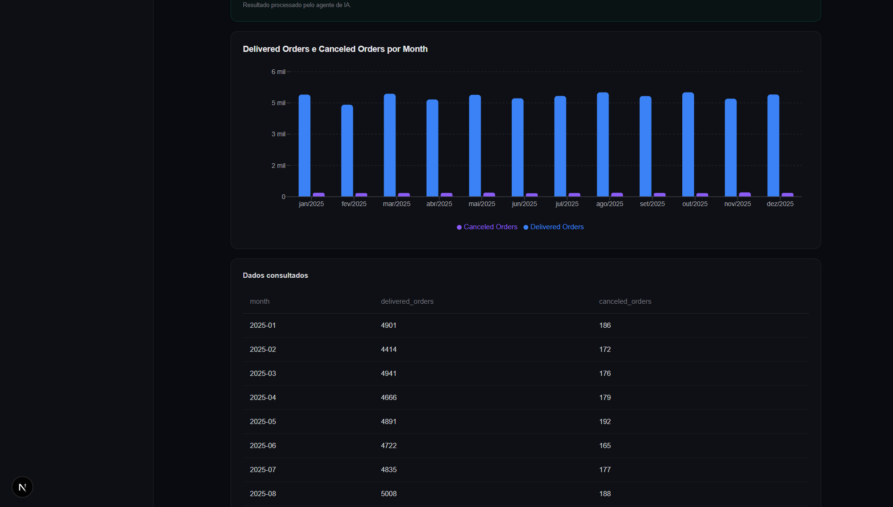
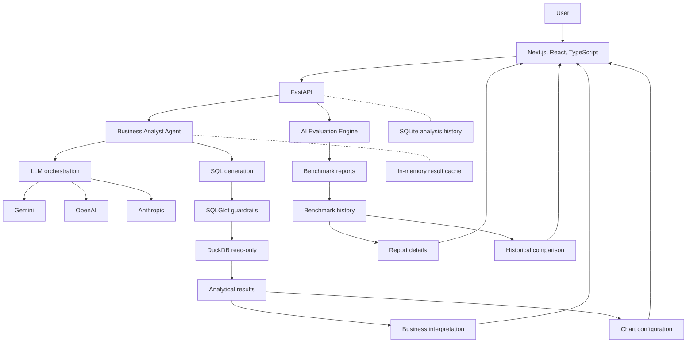
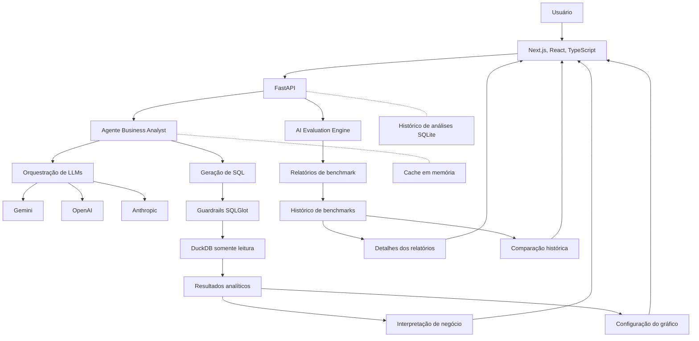

<!-- Main project documentation. Visual assets are recorded manually; see docs/assets/README.md. -->
<a id="top"></a>

<div align="center">


<br/>


[](https://github.com/nascimentomacedodani487-hue/ai-business-analyst/actions/workflows/ci.yml)
-0e7490?style=flat-square)

**[English](#english)** · **[Português](#portugues)**

</div>

---

<a id="english"></a>

# English

**AI Business Analyst is an AI-powered business intelligence and LLM evaluation product, not a simple chatbot.**

It transforms natural-language business questions into validated SQL queries, executes them against a read-only analytical database, and returns results with charts and written business insights.

The platform also includes an AI Evaluation Engine for browsing benchmark history, inspecting evaluation reports and comparing compatible benchmark runs.

> **Status:** Active development (v0.1.0). The application runs locally; there is no hosted deployment or production claim. The business dataset is synthetic.

**Contents:** [Product experience](#product-experience) · [Core capabilities](#core-capabilities) · [AI Evaluation Engine](#ai-evaluation-engine) · [Architecture](#architecture) · [Security](#security-and-reliability) · [Dataset](#dataset) · [Technology stack](#technology-stack) · [Installation](#installation) · [Testing](#testing-and-quality) · [Automation](#automation) · [Roadmap](#roadmap)

## Product experience

<p align="center">
  
</p>

<!-- When docs/assets/demo.gif is recorded from the real application, add:
<p align="center"></p>
-->

> **Demo GIF: pending recording.** Visual assets must be captured from the real running application. See [`docs/assets/README.md`](docs/assets/README.md) for recording instructions. No simulated screenshots are presented as product evidence.

The product has two main workflows:

| Workflow | What it does | Main implementation |
|---|---|---|
| Business analysis | Turns a natural-language question into a validated SQL query, executes it and presents insights | `src/ai_analyst/agent/`, `src/ai_analyst/api/` |
| LLM evaluation | Exposes benchmark history, report details and historical comparisons | `src/ai_analyst/evaluation/`, `src/ai_analyst/api/evaluation.py` |

### Business analysis pipeline

1. The user submits a business question.
2. The agent interprets the request and builds schema context.
3. The selected LLM provider generates SQL.
4. SQLGlot guardrails validate the query at the AST level.
5. A read-only DuckDB connection executes the approved query.
6. Results are interpreted and a chart configuration is generated.
7. The UI presents the SQL, results, chart, business explanation and execution timeline.

### Evaluation workflow

1. Benchmark runs produce evaluation reports.
2. The Evaluation Engine exposes historical benchmark records.
3. A user opens a report to inspect its evaluation details.
4. Compatible reports can be compared to identify metric changes, improvements and regressions.

## Core capabilities

### AI business intelligence

- Natural-language questions over a synthetic delivery marketplace.
- LLM-generated SQL followed by AST-based validation.
- Analytical results presented in tables and charts.
- Written business interpretations.
- Execution timeline with individual processing stages.

### Multi-LLM architecture

- Provider abstraction for Gemini, OpenAI and Anthropic.
- Provider and model selection through the application architecture.
- Retry logic with exponential backoff for transient failures.
- Controlled handling of provider errors, rate limits and timeouts.

Each provider requires its own API credentials for live requests. Automated tests use controlled test doubles where external provider calls are not required.

### Agent orchestration

- Staged workflow: cache lookup, SQL generation, validation, execution, response generation and chart generation.
- Up to two SQL correction attempts for recoverable execution errors.
- In-memory result cache with a 30-minute TTL and a 100-entry limit.
- Separation between agent orchestration, provider integrations, security and data access.

### Analysis management

- Persistent analysis history in SQLite.
- Search, status and project filters.
- Pagination and archived-record visibility.
- Pin, lock, archive, rename, delete and restore operations.
- Projects to organize analyses.

### Observability

- `X-Request-ID` on API responses.
- Structured logs with request identifiers.
- Per-stage execution timing.
- LLM metrics endpoint (`GET /metrics/llm`), including retry information.
- Recorded execution steps and controlled error information.

## AI Evaluation Engine

The AI Evaluation Engine provides a dedicated interface for reviewing historical benchmark runs and examining evaluation results.

**Implemented capabilities:**

- Benchmark history listing.
- Individual benchmark report details.
- Historical comparison between compatible reports.
- Metric-by-metric comparison to identify improvements and regressions.
- Compatibility checks before comparing reports.

### Comparison constraints

Historical comparison is intentionally restricted to compatible reports. The current comparison logic requires matching dataset, provider and model. It does not represent an unrestricted cross-provider comparison.

Financial cost metrics are excluded from historical comparisons because available cost metadata does not necessarily represent the actual amount billed by a provider.

Main implementation:

| Component | Responsibility |
|---|---|
| `src/ai_analyst/evaluation/` | Evaluation and benchmark logic |
| `src/ai_analyst/api/evaluation.py` | Evaluation API routes |
| `frontend/app/evaluation/page.tsx` | Evaluation Engine page |
| `frontend/components/evaluation/benchmark-history.tsx` | Benchmark history, details and comparison interface |
| `frontend/lib/evaluation.ts` | Frontend API integration |

## API surface

The FastAPI application exposes the following areas:

| Area | Main operations |
|---|---|
| Health | `GET /health` |
| Data catalog | `GET /data/catalog` |
| Business analysis | `POST /analyze` |
| LLM metrics | `GET /metrics/llm` |
| Analysis history | History search, filters, pagination and record management |
| Analysis projects | Project creation and management |
| Evaluation Engine | Benchmark history, report details and historical comparison |

Interactive API documentation is available locally at `http://127.0.0.1:8000/docs`.

## Architecture



### Architectural decisions

- **Separation of concerns:** agent orchestration, provider integrations, security, data access and HTTP routes are organized into separate modules.
- **Provider abstraction:** LLM providers share a common interface, allowing the application to select a provider without coupling the agent to a single SDK.
- **SQL validation before execution:** generated SQL is parsed and checked as an AST before reaching the database.
- **Read-only analytical access:** DuckDB runs in read-only mode with external access disabled and configuration locked.
- **Separate persistence concerns:** analytical data is held in DuckDB, while analysis history and projects use SQLite.
- **Evaluation compatibility:** historical comparisons check dataset, provider and model compatibility before calculating differences.
- **Observability:** request IDs, execution timings, LLM metrics and controlled error handling make application behavior easier to inspect.

## Security and reliability

These controls are designed to restrict LLM-generated queries to the intended analytical environment. They are not a claim of absolute security.

| Control | Implementation |
|---|---|
| AST validation | SQL parsed with SQLGlot before execution |
| SELECT-only | Root statements other than `SELECT` are rejected |
| Single statement | Multiple statements are rejected |
| Blocked functions | File, scan and extension functions such as `read_csv`, `read_parquet`, `glob`, `pragma`, `install` and `load` are blocked |
| Table allowlist | Only `orders`, `restaurants`, `customers` and `couriers` are allowed |
| Read-only database | DuckDB connection uses `read_only=True` |
| No external files | `enable_external_access` is disabled and `lock_configuration` is enabled |
| Provider resilience | Retry with backoff and controlled provider error handling |
| SQL correction | Recoverable SQL errors can trigger up to two correction attempts |

The repository includes automated tests for SQL guardrails, query execution, LLM retry logic, caching, analysis history, evaluation and API behavior.

## Dataset

The business dataset is **100% synthetic**, generated by `src/ai_analyst/data/generate.py` with a fixed seed (`42`) so that the generated data is reproducible.

| Entity | Records |
|---|---:|
| Restaurants | 200 |
| Customers | 5,000 |
| Delivery partners | 300 |
| Orders | 60,000 |

The dataset represents a delivery marketplace with five cities and orders from 2025. Generated patterns include lunch and dinner peaks, higher demand from Friday to Sunday, and rain-related increases in delivery time and cancellations.

Of the 60,000 orders:

- 57,828 were delivered.
- 2,172 were cancelled.
- Cancellation rate: 3.62%.

> Insights reflect the deliberately generated patterns, not real marketplace behavior. They must not be interpreted as real-world business benchmarks.

## Technology stack

| Layer | Technologies |
|---|---|
| Backend | Python 3.11+, FastAPI, Uvicorn, Pydantic |
| Frontend | Next.js 16.4.6, React 19, TypeScript, Tailwind CSS |
| Data | DuckDB, SQLite, Pandas, NumPy |
| AI | Gemini (`google-genai`), OpenAI, Anthropic |
| Evaluation | Benchmark runner, evaluation reports and historical comparison |
| Security | SQLGlot |
| Visualization | Recharts |
| Backend quality | Pytest, Ruff |
| Frontend quality | ESLint, TypeScript compiler, Next.js production build |
| Development | Git, GitHub Actions, Node.js, npm |

## Installation

Instructions for Windows PowerShell. Requirements: Python 3.11+ and Node.js 20.9+.

### 1. Clone the repository

```powershell
git clone https://github.com/nascimentomacedodani487-hue/ai-business-analyst.git
cd ai-business-analyst
```

### 2. Configure the backend

```powershell
python -m venv .venv
.\.venv\Scripts\Activate.ps1

pip install -e ".[dev]"

Copy-Item .env.example .env
```

Configure the API key for the provider you intend to use in `.env`:

```text
GEMINI_API_KEY=
OPENAI_API_KEY=
ANTHROPIC_API_KEY=
```

Only the selected provider needs a valid key for live requests. Never commit `.env` or expose API keys in screenshots, logs or documentation.

### 3. Generate the analytical database

```powershell
python -m ai_analyst.data.db
```

### 4. Start the backend

```powershell
python -m uvicorn ai_analyst.api.main:app --reload
```

The API runs at `http://127.0.0.1:8000`.

### 5. Configure and start the frontend

Open a second terminal:

```powershell
cd frontend

npm install

"NEXT_PUBLIC_API_URL=http://127.0.0.1:8000" | Out-File -Encoding ascii .env.local

npm run dev
```

Open `http://localhost:3000` in your browser. Use `localhost` because the API CORS configuration allows `http://localhost:3000`.

## Testing and quality

The following results were verified locally on **November 17, 2026**. They are point-in-time results, not a guarantee that every environment will produce identical execution times.

### Backend

```powershell
python -m pytest -q
ruff check src tests
ruff format --check src tests
```

Verified results:

- **1,214 tests passed**.
- Ruff checks passed.
- 77 Python files already formatted.

### Frontend

```powershell
cd frontend

npx eslint .
npx tsc --noEmit
npm run build
```

Verified results:

- ESLint completed without errors or warnings.
- TypeScript completed without errors.
- Next.js 16.4.6 production build completed successfully.
- Static routes generated: `/`, `/_not-found` and `/evaluation`.

The automated test suite does not require paid OpenAI or Anthropic API calls.

## Automation

| Workflow | Trigger | Purpose |
|---|---|---|
| [`ci.yml`](.github/workflows/ci.yml) | Push to `main` and pull requests | Runs backend tests and the frontend TypeScript check |
| [`snake.yml`](.github/workflows/snake.yml) | Daily and manual | Generates the GitHub contribution snake and publishes it to the `output` branch |

The contribution snake is decorative. It represents the owner's GitHub contribution graph, not the activity of this repository. It appears after `snake.yml` has run and the generated image has been published to the `output` branch.

<details>
<summary><b>About the author</b></summary>

<div align="center">

<a href="https://github.com/nascimentomacedodani487-hue/ai-business-analyst"></a>


<br/>

[](https://www.linkedin.com/in/daniel-macedo-54bb46210/)
[](https://github.com/nascimentomacedodani487-hue)

</div>

The top-languages card reflects the entire GitHub account, not only this project.

</details>

## Roadmap

### Implemented

- [x] Natural-language business analysis with LLM-generated SQL.
- [x] SQL AST guardrails and read-only analytical execution.
- [x] Multi-provider architecture with retry and observability.
- [x] Persistent analysis history and project management.
- [x] AI Evaluation Engine with benchmark history and report details.
- [x] Historical comparison of compatible benchmark reports.

### Next improvements

- [ ] Expand benchmark datasets and evaluation case coverage.
- [ ] Cross-provider benchmark comparison with explicit compatibility criteria.
- [ ] Broader automated frontend testing.
- [ ] Hosted deployment.
- [ ] Real application screenshots and demonstration GIF.

<p align="right"><a href="#top">Back to top ↑</a></p>

---

<a id="portugues"></a>

# Português

**O AI Business Analyst é um produto de inteligência de negócios com IA e avaliação de LLMs, não um simples chatbot.**

Ele transforma perguntas de negócio em linguagem natural em consultas SQL validadas, executa essas consultas em um banco analítico somente leitura e apresenta resultados com gráficos e interpretações de negócio.

A plataforma também possui um AI Evaluation Engine para consultar o histórico de benchmarks, inspecionar relatórios de avaliação e comparar execuções compatíveis.

> **Status:** Em desenvolvimento ativo (v0.1.0). A aplicação roda localmente; ainda não há deploy hospedado nem alegação de uso em produção. O conjunto de dados de negócio é sintético.

**Conteúdo:** [Experiência do produto](#experiência-do-produto) · [Capacidades](#capacidades) · [AI Evaluation Engine](#ai-evaluation-engine-1) · [Arquitetura](#arquitetura) · [Segurança](#segurança-e-confiabilidade) · [Dados](#conjunto-de-dados) · [Tecnologias](#tecnologias) · [Instalação](#instalação) · [Testes](#testes-e-qualidade) · [Automação](#automação) · [Próximos passos](#próximos-passos)

## Experiência do produto

<p align="center">
  
</p>

<!-- Quando docs/assets/demo.gif for gravado a partir da aplicação real, adicione:
<p align="center"></p>
-->

> **GIF de demonstração: gravação pendente.** Os materiais visuais devem ser capturados a partir da aplicação real em execução. Consulte [`docs/assets/README.md`](docs/assets/README.md) para as instruções. Não são utilizadas capturas simuladas como evidência do produto.

O produto possui dois fluxos principais:

| Fluxo | O que faz | Implementação principal |
|---|---|---|
| Análise de negócio | Transforma uma pergunta em linguagem natural em SQL validado, executa a consulta e apresenta insights | `src/ai_analyst/agent/`, `src/ai_analyst/api/` |
| Avaliação de LLMs | Disponibiliza histórico de benchmarks, detalhes de relatórios e comparações históricas | `src/ai_analyst/evaluation/`, `src/ai_analyst/api/evaluation.py` |

### Pipeline de análise de negócio

1. O usuário envia uma pergunta de negócio.
2. O agente interpreta a solicitação e monta o contexto do schema.
3. O provedor de LLM selecionado gera o SQL.
4. Os guardrails do SQLGlot validam a consulta no nível da AST.
5. Uma conexão DuckDB somente leitura executa a consulta aprovada.
6. Os resultados são interpretados e a configuração do gráfico é gerada.
7. A interface apresenta SQL, resultados, gráfico, explicação de negócio e linha do tempo de execução.

### Fluxo de avaliação

1. Execuções de benchmark produzem relatórios de avaliação.
2. O Evaluation Engine disponibiliza os registros históricos.
3. O usuário abre um relatório para inspecionar seus detalhes.
4. Relatórios compatíveis podem ser comparados para identificar mudanças nas métricas, melhorias e regressões.

## Capacidades

### Inteligência de negócios com IA

- Perguntas em linguagem natural sobre um marketplace de delivery sintético.
- Geração de SQL por LLM, seguida de validação por AST.
- Resultados analíticos apresentados em tabelas e gráficos.
- Interpretações de negócio escritas.
- Linha do tempo com as etapas de processamento.

### Arquitetura multi-LLM

- Abstração de provedores para Gemini, OpenAI e Anthropic.
- Seleção de provedor e modelo pela arquitetura da aplicação.
- Lógica de retry com backoff exponencial para falhas transitórias.
- Tratamento controlado de erros de provedor, limites de taxa e timeouts.

Cada provedor exige suas próprias credenciais para chamadas reais. Os testes automatizados utilizam implementações controladas de teste quando não é necessária uma chamada externa.

### Orquestração do agente

- Fluxo em etapas: consulta ao cache, geração de SQL, validação, execução, geração de resposta e gráfico.
- Até duas tentativas de correção de SQL em erros recuperáveis.
- Cache de resultados em memória com TTL de 30 minutos e limite de 100 entradas.
- Separação entre orquestração, integração com provedores, segurança e acesso a dados.

### Gestão de análises

- Histórico persistente em SQLite.
- Busca, filtros por status e projeto.
- Paginação e visualização de registros arquivados.
- Fixar, bloquear, arquivar, renomear, excluir e restaurar análises.
- Projetos para organizar análises.

### Observabilidade

- `X-Request-ID` nas respostas da API.
- Logs estruturados com identificadores de requisição.
- Tempo de execução por etapa.
- Endpoint de métricas de LLM (`GET /metrics/llm`), incluindo informações de retry.
- Registro de etapas de execução e informações controladas de erro.

## AI Evaluation Engine

O AI Evaluation Engine oferece uma interface dedicada para consultar benchmarks históricos e inspecionar resultados de avaliação.

**Funcionalidades implementadas:**

- Listagem do histórico de benchmarks.
- Detalhes individuais dos relatórios.
- Comparação histórica entre relatórios compatíveis.
- Comparação métrica a métrica para identificar melhorias e regressões.
- Verificação de compatibilidade antes da comparação.

### Restrições da comparação

A comparação histórica é intencionalmente restrita a relatórios compatíveis. A implementação atual exige correspondência de dataset, provedor e modelo. Portanto, ainda não representa uma comparação irrestrita entre provedores diferentes.

Métricas financeiras são excluídas das comparações históricas porque os metadados de custo disponíveis não representam necessariamente o valor efetivamente cobrado pelo provedor.

Implementação principal:

| Componente | Responsabilidade |
|---|---|
| `src/ai_analyst/evaluation/` | Lógica de avaliação e benchmarks |
| `src/ai_analyst/api/evaluation.py` | Rotas da API de avaliação |
| `frontend/app/evaluation/page.tsx` | Página do Evaluation Engine |
| `frontend/components/evaluation/benchmark-history.tsx` | Interface de histórico, detalhes e comparação |
| `frontend/lib/evaluation.ts` | Integração do frontend com a API |

## Superfície da API

A aplicação FastAPI disponibiliza as seguintes áreas:

| Área | Operações principais |
|---|---|
| Saúde | `GET /health` |
| Catálogo de dados | `GET /data/catalog` |
| Análise de negócio | `POST /analyze` |
| Métricas de LLM | `GET /metrics/llm` |
| Histórico de análises | Busca, filtros, paginação e gerenciamento de registros |
| Projetos de análise | Criação e gerenciamento de projetos |
| Evaluation Engine | Histórico de benchmarks, detalhes de relatórios e comparação histórica |

A documentação interativa da API fica disponível localmente em `http://127.0.0.1:8000/docs`.

## Arquitetura



### Decisões de arquitetura

- **Separação de responsabilidades:** orquestração do agente, integração com provedores, segurança, acesso a dados e rotas HTTP são organizados em módulos distintos.
- **Abstração de provedores:** os provedores de LLM compartilham uma interface, permitindo selecionar um modelo sem acoplar o agente a um único SDK.
- **Validação do SQL antes da execução:** o SQL gerado é analisado e validado como AST antes de chegar ao banco.
- **Acesso analítico somente leitura:** o DuckDB funciona em modo somente leitura, com acesso externo desabilitado e configuração travada.
- **Persistência separada por responsabilidade:** os dados analíticos ficam no DuckDB, enquanto histórico de análises e projetos usam SQLite.
- **Compatibilidade na avaliação:** comparações históricas verificam dataset, provedor e modelo antes de calcular diferenças.
- **Observabilidade:** request IDs, tempos de execução, métricas de LLM e tratamento controlado de erros facilitam a inspeção do comportamento da aplicação.

## Segurança e confiabilidade

Estes controles foram projetados para restringir as consultas geradas por LLM ao ambiente analítico pretendido. Não representam uma alegação de segurança absoluta.

| Controle | Implementação |
|---|---|
| Validação por AST | SQL analisado com SQLGlot antes da execução |
| Somente SELECT | Instruções cuja raiz não seja `SELECT` são rejeitadas |
| Instrução única | Múltiplas instruções são rejeitadas |
| Funções bloqueadas | Funções de arquivo, scan e extensões como `read_csv`, `read_parquet`, `glob`, `pragma`, `install` e `load` são bloqueadas |
| Allowlist de tabelas | Apenas `orders`, `restaurants`, `customers` e `couriers` são permitidas |
| Banco somente leitura | Conexão DuckDB utiliza `read_only=True` |
| Sem arquivos externos | `enable_external_access` é desabilitado e `lock_configuration` é habilitado |
| Resiliência dos provedores | Retry com backoff e tratamento controlado de erros |
| Correção de SQL | Erros recuperáveis podem gerar até duas tentativas de correção |

O repositório inclui testes automatizados para guardrails de SQL, execução de consultas, retry de LLM, cache, histórico de análises, avaliação e comportamento da API.

## Conjunto de dados

O conjunto de dados de negócio é **100% sintético**, gerado por `src/ai_analyst/data/generate.py` com seed fixa (`42`), tornando os dados reproduzíveis.

| Entidade | Registros |
|---|---:|
| Restaurantes | 200 |
| Clientes | 5.000 |
| Entregadores | 300 |
| Pedidos | 60.000 |

O dataset representa um marketplace de delivery com cinco cidades e pedidos de 2025. Foram inseridos padrões como picos de almoço e jantar, maior demanda de sexta a domingo e aumento do tempo de entrega e dos cancelamentos em dias de chuva.

Dos 60.000 pedidos:

- 57.828 foram entregues.
- 2.172 foram cancelados.
- Taxa de cancelamento: 3,62%.

> Os insights refletem padrões gerados intencionalmente, não o comportamento real de um marketplace. Não devem ser interpretados como benchmarks de negócio do mundo real.

## Tecnologias

| Camada | Tecnologias |
|---|---|
| Backend | Python 3.11+, FastAPI, Uvicorn, Pydantic |
| Frontend | Next.js 16.4.6, React 19, TypeScript, Tailwind CSS |
| Dados | DuckDB, SQLite, Pandas, NumPy |
| IA | Gemini (`google-genai`), OpenAI, Anthropic |
| Avaliação | Runner de benchmarks, relatórios e comparação histórica |
| Segurança | SQLGlot |
| Visualização | Recharts |
| Qualidade do backend | Pytest, Ruff |
| Qualidade do frontend | ESLint, compilador TypeScript, build Next.js |
| Desenvolvimento | Git, GitHub Actions, Node.js, npm |

## Instalação

Instruções para Windows PowerShell. Requisitos: Python 3.11+ e Node.js 20.9+.

### 1. Clonar o repositório

```powershell
git clone https://github.com/nascimentomacedodani487-hue/ai-business-analyst.git
cd ai-business-analyst
```

### 2. Configurar o backend

```powershell
python -m venv .venv
.\.venv\Scripts\Activate.ps1

pip install -e ".[dev]"

Copy-Item .env.example .env
```

Configure no `.env` a chave do provedor que pretende utilizar:

```text
GEMINI_API_KEY=
OPENAI_API_KEY=
ANTHROPIC_API_KEY=
```

Somente o provedor selecionado precisa de uma chave válida para chamadas reais. Nunca faça commit do `.env` nem exponha chaves em screenshots, logs ou documentação.

### 3. Gerar o banco analítico

```powershell
python -m ai_analyst.data.db
```

### 4. Iniciar o backend

```powershell
python -m uvicorn ai_analyst.api.main:app --reload
```

A API estará disponível em `http://127.0.0.1:8000`.

### 5. Configurar e iniciar o frontend

Abra um segundo terminal:

```powershell
cd frontend

npm install

"NEXT_PUBLIC_API_URL=http://127.0.0.1:8000" | Out-File -Encoding ascii .env.local

npm run dev
```

Abra `http://localhost:3000` no navegador. Use `localhost` porque a configuração CORS da API permite `http://localhost:3000`.

## Testes e qualidade

Os resultados abaixo foram verificados localmente em **17 de novembro de 2026**. São resultados de um momento específico, não uma garantia de que todo ambiente terá tempos de execução idênticos.

### Backend

```powershell
python -m pytest -q
ruff check src tests
ruff format --check src tests
```

Resultados verificados:

- **1.214 testes aprovados**.
- Verificações do Ruff aprovadas.
- 77 arquivos Python já formatados.

### Frontend

```powershell
cd frontend

npx eslint .
npx tsc --noEmit
npm run build
```

Resultados verificados:

- ESLint concluído sem erros ou avisos.
- TypeScript concluído sem erros.
- Build de produção do Next.js 16.4.6 concluído com sucesso.
- Rotas estáticas geradas: `/`, `/_not-found` e `/evaluation`.

A suíte automatizada não exige chamadas pagas às APIs da OpenAI ou Anthropic.

## Automação

| Workflow | Gatilho | Finalidade |
|---|---|---|
| [`ci.yml`](.github/workflows/ci.yml) | Push na `main` e pull requests | Executa os testes do backend e a checagem TypeScript do frontend |
| [`snake.yml`](.github/workflows/snake.yml) | Diário e manual | Gera a cobrinha de contribuições do GitHub e publica na branch `output` |

A cobrinha é decorativa. Ela representa o gráfico de contribuições da conta do proprietário no GitHub, não a atividade deste repositório. A imagem aparece depois que `snake.yml` é executado e o arquivo gerado é publicado na branch `output`.

<details>
<summary><b>Sobre o autor</b></summary>

<div align="center">

<a href="https://github.com/nascimentomacedodani487-hue/ai-business-analyst"></a>


<br/>

[](https://www.linkedin.com/in/daniel-macedo-54bb46210/)
[](https://github.com/nascimentomacedodani487-hue)

</div>

O card de linguagens reflete toda a conta do GitHub, não apenas este projeto.

</details>

## Próximos passos

### Implementado

- [x] Análise de negócio em linguagem natural com SQL gerado por LLM.
- [x] Guardrails de SQL por AST e execução analítica somente leitura.
- [x] Arquitetura multi-provedor com retry e observabilidade.
- [x] Histórico persistente de análises e gerenciamento de projetos.
- [x] AI Evaluation Engine com histórico de benchmarks e detalhes dos relatórios.
- [x] Comparação histórica entre relatórios de benchmark compatíveis.

### Melhorias futuras

- [ ] Expandir os datasets de benchmark e a cobertura dos casos de avaliação.
- [ ] Comparação de benchmarks entre provedores com critérios explícitos de compatibilidade.
- [ ] Ampliar os testes automatizados do frontend.
- [ ] Deploy hospedado.
- [ ] Screenshots reais e GIF de demonstração da aplicação.

<p align="right"><a href="#top">Voltar ao topo ↑</a></p>
